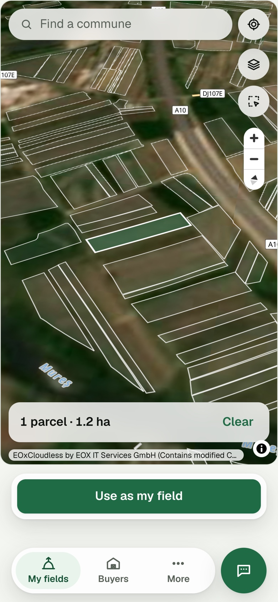
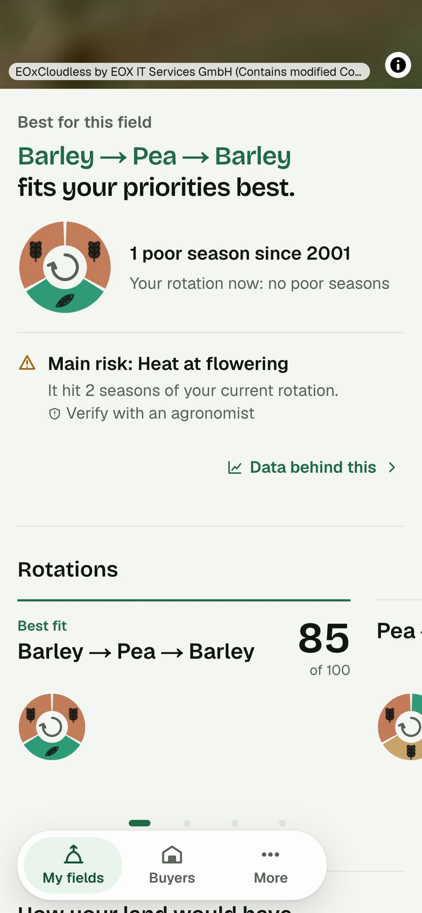
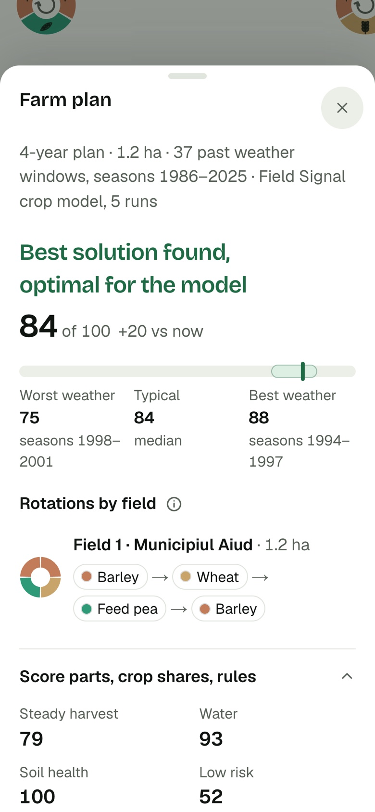
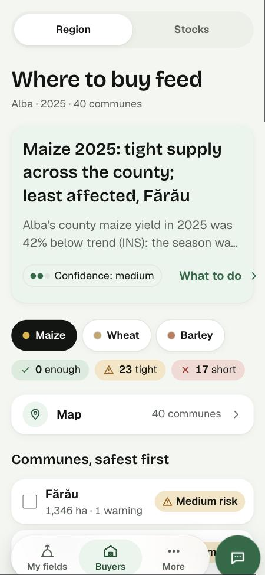

# Field Signal

Field Signal helps a Romanian farmer choose a crop rotation for a real field, and helps a feed buyer see where next year's grain is likely to come from. A model trained on eight years of NASA satellite observations replays 25 seasons of weather on the farmer's own parcels and compares the rotation they grow now with the alternatives.

Built by team Farm Titans at the **NASA Space Apps Challenge 2026** (14–15 Nov 2026) for the challenge *Field Shift: Adapting Farms with NASA Data*, with the local SPACE2FEED track (livestock feed). This is an independent hackathon project; it is not endorsed by or affiliated with NASA.

| | |
|---|---|
| App | https://fieldsignal.land |
| API docs | https://api.fieldsignal.land/docs |
| Pitch deck | https://fieldsignal.land/pitch |

<p align="center">
  
  
  
  
</p>

## What it does

### For farmers

- **Pick your field on the map.** Tap the parcels you declared to APIA, or drag over several. Parcels can be joined into one field or kept as separate fields, up to 10 fields per analysis. The parcel layer covers Alba county (171,607 parcels from the 2025 campaign).
- **Say what you grow and what matters.** Enter your current rotation and weigh four priorities: steady harvest, coping with drought, soil health, fewer bad years.
- **Compare rotations.** The app scores your rotation against the three best other 3-year rotations of maize, wheat, barley, sunflower and pea. Each gets a fit score out of 100 with a likely range, a season-by-season replay of 2001–2025 with the weather behind each poor year, and the main risk. The same screen shows July hot days, summer rain, predicted peak NDVI and root-zone soil moisture over the years, the field's soil, and the plan on the map season by season. Results can be shared by link or printed on one page.
- **Get a farm plan.** An optimizer assigns a rotation to each analysed field so the fields together score best across past weather, shows the score in the worst, typical and best weather, and checks the result against simplified CAP crop-rotation and diversification rules.
- **Import a whole farm.** Upload the parcel export from AGI Online (or a zipped shapefile, GeoJSON or KML). Outlines are matched to the APIA parcels, grouped into suggested fields you can rearrange, and planned so the farm grows an even mix each year. Each parcel shows the crops mapped on it in 2018 and 2022, and parcels whose soil differs from the rest of the farm are flagged. The plan downloads as a checklist to copy into AGI Online. Two demo farms are built in.
- **Keep your fields.** Fields and results stay on the phone, or in an account (email and password) that also stores the farm.
- **Ask questions.** An in-app assistant answers from your fields, their analyses and the knowledge base, and can take longer to reason on harder questions. A WhatsApp bot summarises the analysis for a location pin and answers follow-up questions (see [its README](services/api/src/api/whatsapp/README.md)); it runs on a Meta test number, which only answers allow-listed phones.
- **Watch a rotation on a field.** A 3D simulator shows each crop sown, grown and harvested through the years. It is an illustration, not a work plan.

### For feed buyers

- **Region.** A map of the yield outlook for 2027 and 2028 in 136 regions (NUTS3) of Romania, Hungary, Bulgaria, Croatia, Slovakia, eastern Austria and northern Serbia, for wheat, barley, maize, rapeseed, sunflower, soybeans and dry pulses. Each region shows its typical yield and how far a bad weather year would pull it down.
- **Stocks.** Days of cover per feed ingredient on two production lines, the ingredient that runs out first, supplier countries ranked on coverage, reliability, logistics and ease of trade, a recommended purchase split, and a printable procurement report in Romanian with a summary written by a language model. The stock levels and supplier volumes are a built-in demo scenario.

### Across the app

English and Romanian, phone-first with a desktop layout, light and dark themes, installable as a PWA with an offline shell.

## What is real and what is demo

| Part | Status |
|---|---|
| Field analysis, multi-field farm plan | The trained model, live. Responses carry `mock: false`. |
| Parcels, crop history and soil per parcel | Real data: APIA 2025, EUCROPMAP 2018 and 2022, SoilGrids. Alba county only. |
| Yield outlook | Model output. For wheat, barley, rapeseed and dry pulses the model chain did not beat the regional average in the 2022–2024 test, and the data file labels them so. |
| Stocks | Demo scenario. Only the arithmetic and the report are real. |
| Simulator, start-page animation | Illustrations on a demo field. |
| API unreachable or offline | The app falls back to bundled demo data under a "Demo data" banner. |

## How it works

### Field model

A one-layer LSTM (`model/code/model.py`) predicts next month's change in NDVI and root-zone soil moisture from this month's state, the month's weather (ten NASA POWER channels, including FAO-56 reference evapotranspiration), the crop, the two previous crops, and the soil and terrain of the point.

- **Training data.** About 366,000 cropland sample points in Romania, Hungary, Bulgaria, Croatia, Slovakia, eastern Austria and Vojvodina, October 2016 to September 2024: monthly NDVI from NASA HLS (30 m), root-zone soil moisture from NASA SMAP L4, yearly crop labels from the Copernicus HRL Crop Types layer.
- **Split.** By region, fixed in `model/code/split.py`: about 306,000 points for training, 19,997 for validation, 39,588 for the test, in 11 regions of 7 countries that the model never saw (Alba among them).
- **Test.** From September 2021 the model runs 36 months on its own predictions, with observed weather and crops. Against observations in 2022–2024: NDVI mean absolute error 0.087–0.093 (R² 0.65–0.69), root-zone soil moisture 0.020–0.021 m³/m³ (R² 0.84–0.88). Full metrics: `model/runs/monthly_delta/test_metrics.json`.
- **Ensemble.** Five training seeds. Their spread is too narrow to be read as an uncertainty range: on the validation regions it contains the observed value 24% of the time for NDVI and 33% for soil moisture, where 67% would be ideal (`ensemble.json`).

The API runs the five exported networks in numpy (`services/api/src/api/planner/world_model.py`); a test checks that this matches the PyTorch rollout. For a planned field it simulates each crop year under the real weather of every season from 1986 to 2025.

### Scores

Four scores from 0 to 100, defined in `services/api/src/api/planner/scoring.py`, combined with the farmer's weights:

| Score | What it uses |
|---|---|
| Steady harvest | Predicted peak NDVI of the crop, relative to that crop's normal year at that place |
| Water | Share of the water a good-year crop would use at flowering that a soil-water balance says it gets |
| Soil health | Green cover outside the main crop's season, and the share of legume years |
| Low risk | The weakest plan year at the low end of the ensemble |

The harvest figure is a greenness proxy, not tonnes per hectare, and no score covers prices, costs, nutrients, pests or disease.

### Farm optimizer

A CP-SAT solver (Google OR-Tools, `planner/optimizer.py`) picks one rotation per field from every valid candidate. It maximises the area-weighted score summed over all past weather windows, with extra weight on the worst window. Each field keeps one rotation that changes crop every year. The API can also enforce the PD-04 eco-scheme's crop diversification or legume share, which may split large fields between rotations; the app does not offer that switch yet. Plans run as background jobs so a slow one does not block the API. The rule checks are simplified guidance, not a compliance test.

### Yield models and the buyers' outlook

One XGBoost model per crop (`model/code/yield_models.py`) relates regional yield to NDVI peak and NDVI sum, trained on Eurostat NUTS2 yields for 2017–2024 in seven countries and scored by leaving out one harvest year at a time, against each region's mean yield in the other years:

| Crop | Model R² | Baseline R² |
|---|---|---|
| Maize | 0.73 | 0.21 |
| Sunflower | 0.57 | 0.21 |
| Wheat | 0.54 | 0.46 |
| Soybeans | 0.37 | 0.24 |
| Rapeseed | 0.30 | 0.21 |
| Barley | 0.62 | 0.62 |
| Dry pulses | 0.36 | 0.44 |

For the outlook, the LSTM ensemble is rolled forward under each weather year from 1985 to 2025 and its NDVI is fed to the yield models, which gives a low, typical and high yield per region and crop (`model/code/supply_chain.py`, results in `model/data/supply/`). With predicted instead of observed NDVI, only maize, sunflower and soybeans still beat the regional average on 2022–2024. According to `model/data/supply/report.md`, this chain used the non-delta variant of the ensemble, whose checkpoints are not in this repo.

### Assistants

The in-app assistant and the WhatsApp bot call a chat model (Qwen by default, through any OpenAI-compatible endpoint). The model can look up the farmer's fields, a field's analysis, a comparison of all fields and the regional supply table, and the prompt forbids numbers that did not come from those. The numbers in WhatsApp result messages come from fixed templates, never from the model. The stocks report summary is dropped if it quotes a number that is not in the computed facts.

## Limits

- Weather describes a cell about 50 km wide and soil comes from 250 m maps, so two neighbouring fields often get the same inputs.
- The model sees crops, weather, soil and terrain. It does not see hybrids, sowing dates, fertiliser, irrigation, pests, hail or prices.
- Crop calendars and thresholds in `data/crops.toml` and the constants of the soil-water balance are drafts that no agronomist has reviewed.
- Parcel picking and farm import work in Alba county only. Through the API, the field model runs for points across Romania.
- Farm plan jobs are kept in the API's memory, so the API runs as a single replica.

## Repo map

```
apps/web/        Next.js 16 app (React 19, TypeScript, Tailwind 4, next-intl, MapLibre GL, three.js)
services/api/    FastAPI service (Python 3.12, pydantic v2, OR-Tools)
  src/api/planner/     model inference, scoring, optimizer, background jobs
  src/api/whatsapp/    WhatsApp bot
model/           training and evaluation code, checkpoints, metrics, yield models, supply tables
data/            farm_data package and scripts: weather tables, soil grid, parcels, pilot features
contracts/       JSON Schemas generated from the API's pydantic models
docs/            challenge brief, decision log, design and optimizer notes
scripts/         Azure deploy script, contract type generator
```

`ml/` is an unused workspace stub; the models live in `model/`.

## Run it locally

Requirements: Node 22 or newer, pnpm 10, [uv](https://docs.astral.sh/uv/) (it installs Python 3.12), and the GitHub CLI for the two data downloads.

```bash
pnpm install
uv sync --all-packages        # or: uv sync --package api --group dev  (API only, much lighter)

# Parcel outlines and the model's soil grid are too large for git; they are release assets.
gh release download apia-parcels-2025 -p apia_parcels_alba.sqlite -D services/api/parcels
gh release download world-model-static -p static_grid.npy -D services/api/src/api/planner/data

pnpm dev:api                  # http://localhost:8000, docs at /docs
pnpm dev:web                  # http://localhost:3000 (English; /ro for Romanian)
```

Without the soil grid the API answers from a mock model and marks every response `mock: true`. Without the parcel file the map has no parcels to tap.

A `.env` file (copy `.env.example`) is only needed for optional parts: `LLM_API_KEY`, `LLM_BASE_URL` and `LLM_MODEL` for the assistant and the report summary, the `WHATSAPP_*` variables for the bot, `DATABASE_URL` for Postgres (accounts use a local SQLite file otherwise), and Earthdata credentials for the AppEEARS data script.

Checks, the same ones CI runs:

```bash
pnpm lint                     # eslint, tsc, ruff, mypy
pnpm --filter web test        # web unit tests and the EN/RO message check
uv run pytest -q services/api
```

Rebuilding the data is described in [`data/README.md`](data/README.md), the model pipeline in [`model/code/README.md`](model/code/README.md), and the shared formats in [`contracts/README.md`](contracts/README.md).

## API

Interactive docs are at https://api.fieldsignal.land/docs.

| Endpoint | Purpose |
|---|---|
| `POST /v1/fields/analyze` | Analysis of one field: rotations, scores, 25-season replay, indicators, soil |
| `POST /v1/farm/optimize/jobs`, `GET /v1/farm/optimize/jobs/{id}` | Multi-field plan as a background job (`POST /v1/farm/optimize` runs it inline) |
| `GET /v1/parcels`, `POST /v1/parcels/merge` | APIA parcels in a map view; join parcels into one field |
| `POST /v1/farm/import`, `/rematch`, `/suggest`, `/plan` | Farm file import, re-matching to a new parcel layer, suggested fields, staggered farm plan |
| `/v1/auth/*`, `/v1/me/fields`, `/v1/me/farm` | Accounts, saved fields and analyses, saved farm |
| `POST /v1/assistant/chat`, `/stream` | In-app assistant |
| `GET /v1/sourcing/region` | Supply table for 40 Alba communes; feeds the commune search and the assistant |
| `POST /v1/sourcing/brief` | Summary text for the stocks report |
| `GET`, `POST /v1/whatsapp/webhook` | WhatsApp bot |

## Deploy

Both apps run on Azure Container Apps in resource group `rg-field-signal`. The web app scales between 1 and 4 replicas; the API runs one replica with 2 vCPU and 4 GiB. Accounts are stored in Azure Database for PostgreSQL.

Every push to `main` that passes CI deploys automatically (`.github/workflows/deploy.yml`): the workflow downloads the parcel file and the soil grid from the releases, builds both images, rolls them out and smoke-tests the site. Day-to-day work goes to `dev` and reaches `main` through a PR. To deploy by hand, after `az login`, run `scripts/deploy-azure.sh` (pass `api` or `web` to deploy only one).

DNS for fieldsignal.land is on Cloudflare (DNS only); both domains are custom domains on the Container Apps with Azure-managed certificates. The web image bakes in the API URL (`https://api.fieldsignal.land`) at build time.

## Team

| Who | Built |
|---|---|
| Vlad | Web app, API, accounts, farm import, assistants, deployment |
| Bogdan | Data pipelines, farm planner and optimizer, buyers' stocks |
| Răzvan | Field model, yield models, yield outlook |

## Data sources

Every input is public. Licence and attribution text is quoted from each provider's own page; where a term could not be confirmed, the row says so.

### Behind the models

| Dataset | Provider | Resolution, years | Used for | Terms |
|---|---|---|---|---|
| NASA POWER Daily API, AG community: `T2M_MAX`, `T2M_MIN`, `PRECTOTCORR`, `RH2M`, `WS2M`, `ALLSKY_SFC_SW_DWN`, `GWETROOT`; FAO-56 ET₀ computed from them | NASA Langley Research Center, POWER Project | Meteorology from MERRA-2, 0.5° × 0.625°; solar from CERES, 1°. 1981–2025, solar and ET₀ from 1984 | Training weather (`model/code/weather.py`); the API's weather tables for the 110 cells that touch Romania (`farm_data.power_grid`, `farm_data.world_weather`); pilot features (`farm_data.power`) | POWER asks for the acknowledgement quoted below |
| NASA Harmonized Landsat Sentinel-2 v2.0, `HLSL30` and `HLSS30` | NASA LP DAAC, read through Google Earth Engine | 30 m; October 2016 – September 2024, monthly NDVI after cloud, shadow and snow masking | The NDVI the field model learns (`model/code/gee.py`) | NASA EOSDIS data, no use restriction; citation below |
| NASA SMAP L4 Global 3-hourly 9 km Surface and Root Zone Soil Moisture, `SPL4SMGP.008` | NASA NSIDC DAAC, read through Google Earth Engine | 9 km, model-assimilated, so one value covers many fields; 2016–2024 | The root-zone soil moisture the field model learns | NASA EOSDIS data, no use restriction; NSIDC requires the citation below |
| NASA SRTM Global 1 arc second v003 (`SRTMGL1`) | NASA JPL, LP DAAC, read through Google Earth Engine | 30 m | Elevation and slope in training | NASA EOSDIS data, no use restriction; citation below |
| Copernicus DEM GLO-30 | European Space Agency, Airbus; public tiles on AWS | 30 m | Elevation and slope on the API's grid, standing in for SRTM (`farm_data.static_grid`) | Free licence; required notice below |
| ISRIC SoilGrids 2.0: clay, sand, organic carbon, pH(H₂O), depth-weighted to 0–30 cm | ISRIC – World Soil Information | 250 m | Training, the API's soil grid, soil per parcel (`farm_data.soil`, `farm_data.static_grid`) | CC BY 4.0 |
| High Resolution Layer Crop Types, with its confidence layer | Copernicus Land Monitoring Service, through the Copernicus Data Space | 10 m, yearly, 2017–2024 | Crop labels per point and year, and where to sample points (`model/code/hrl.py`, `points.py`) | Free, full and open access; required mention below |
| Crop production in EU standard humidity by NUTS 2 regions, `apro_cpshr` | European Commission, Eurostat | NUTS2, 2017–2024; yield computed as production divided by area | Yield models (`model/code/yield_models.py`) | Reuse authorised provided the source is acknowledged |
| GISCO NUTS 2021 boundaries (1:20 million and 1:60 million) | European Commission, Eurostat (GISCO) | NUTS levels 0–3 | Regions for sampling, the train/test split and the outlook map | GISCO terms quoted below |

### Behind parcels and the Alba supply table

| Dataset | Provider | Resolution, years | Used for | Terms |
|---|---|---|---|---|
| Farm parcels declared in AGI ONLINE single applications (LPIS), campaign 2025 | Agenția de Plăți și Intervenție pentru Agricultură (APIA), on data.gov.ro | Parcel polygons, Alba county | The parcels a farmer taps and a farm file is matched to (`data/scripts/build_apia_parcels.py`); crop areas per commune | CC BY 4.0; modified (filtered to Alba, simplified, crop history and soil added) |
| JRC EUCROPMAP 2018 and 2022 | European Commission, Joint Research Centre | 10 m. 2022: overall accuracy 79.3% (7 classes), 70.6% (19 crops) | Crop history per parcel; cropland sample points and crop areas (`farm_data.cropmap`) | Reuse authorised provided the source is acknowledged. Contains modified Copernicus Sentinel data |
| NASA MODIS Vegetation Indices 16-day 250 m, `MOD13Q1.061` and `MYD13Q1.061` | NASA LP DAAC, through the Microsoft Planetary Computer copy (`modis-13Q1-061`) | Read at the ~463 m overview pixel, no QA layer, Terra and Aqua mixed; 2001–2025, no composites from 2025-06-26 to 2025-11-17 | NDVI in the pilot feature table (`farm_data.modis_cube`) | NASA EOSDIS data, no use restriction; citation below |
| TEMPO-Online `AGR108A` (area), `AGR109A` (production), `AGR110A` (yield) | Institutul Național de Statistică (INS) | County, yearly, 1990–2025 | County yields to check the supply risk rule (`farm_data.ins`) | Reuse terms not verified |
| GISCO NUTS 2024 and LAU 2024 | European Commission, Eurostat (GISCO) | Counties and communes | Pilot zones; a commune's id is its SIRUTA code (`farm_data.zones`) | GISCO terms quoted below |

These feed the pilot feature table (`data/scripts/build_features.py`) and the supply table for 40 Alba communes that the API serves (`data/scripts/build_sourcing.py`).

### Maps and images

| Dataset | Provider | Used for | Terms |
|---|---|---|---|
| OpenFreeMap vector tiles (OpenMapTiles schema, OpenStreetMap data), with Natural Earth shaded relief | OpenFreeMap; OpenMapTiles; OpenStreetMap contributors; Natural Earth | Basemap | OpenStreetMap data under the ODbL; attribution shown on the map. Natural Earth is public domain |
| EOxCloudless 2025 (Sentinel-2 cloudless mosaic, 10 m) | EOX IT Services GmbH | Satellite basemap | CC BY-NC-SA 4.0 for non-commercial use; commercial use needs a separate EOX licence. Credit shown on the map |
| Terrain Tiles, Terrarium encoding | Mapzen / Tilezen, on the AWS Open Data registry | 3D terrain and hillshade | Attribution required (list below) |
| MODIS Terra Corrected Reflectance, Transylvania on 2025-07-02 | NASA Worldview Snapshots (GIBS, ESDIS) | Start-page image | NASA EOSDIS imagery, no use restriction; credited on the page |

### In the repo, behind no number in the app

- `farm_data.appeears` requests MODIS and SMAP point samples from NASA AppEEARS. Its tasks had not returned when the pilot table was built, so that table takes NDVI from the MODIS cube above and its SMAP column is empty.
- `farm_data.firms` counts NASA FIRMS fire detections on cropland, and `farm_data.landmask` builds an arable mask. Nothing reads their output.
- `data/reference/crop_traits_A.csv` and `data/reference/ipcc_soil_ef.csv` hold crop traits and emission factors collected from the literature, each row with its source. No code reads them yet. Their sources are listed below.

<details>
<summary><b>Acknowledgements and citations</b></summary>

- **NASA POWER:** "The data was obtained from National Aeronautics and Space Administration (NASA) Langley Research Center's Prediction Of Worldwide Energy Resources (POWER) project funded through the NASA Earth Science Division." The data was obtained from the POWER Project's Daily 2.10.3 version on 2026/11/13.
- **NASA EOSDIS data (HLS, SMAP, SRTM, MODIS):** "While there are no restrictions on the use of these data, data users are very strongly urged to cite the data used in their work products." ([EOSDIS data use guidance](https://www.earthdata.nasa.gov/engage/open-data-services-software-policies/data-use-guidance))
- **HLS (LP DAAC):** Masek, J., Ju, J., Roger, J., Skakun, S., Vermote, E., Claverie, M., Dungan, J., Yin, Z., Freitag, B., Justice, C. (2021). HLS Operational Land Imager Surface Reflectance and TOA Brightness Daily Global 30m v2.0. NASA EOSDIS Land Processes DAAC. https://doi.org/10.5067/HLS/HLSL30.002. Masek, J., Ju, J., Roger, J., Skakun, S., Vermote, E., Claverie, M., Dungan, J., Yin, Z., Freitag, B., Justice, C. (2021). HLS Sentinel-2 Multi-spectral Instrument Surface Reflectance Daily Global 30m v2.0. NASA EOSDIS Land Processes DAAC. https://doi.org/10.5067/HLS/HLSS30.002.
- **SMAP (NSIDC):** "As a condition of using these data, you must cite the use of this data set." Reichle, R., De Lannoy, G., Koster, R. D., Crow, W. T., Kimball, J. S., Liu, Q. & Bechtold, M. (2025). SMAP L4 Global 3-hourly 9 km EASE-Grid Surface and Root Zone Soil Moisture Geophysical Data. (SPL4SMGP, Version 8). [Data Set]. Boulder, Colorado USA. NASA National Snow and Ice Data Center Distributed Active Archive Center. https://doi.org/10.5067/T5RUATAQREF8.
- **SRTM (LP DAAC):** NASA JPL (2013). NASA Shuttle Radar Topography Mission Global 1 arc second. NASA EOSDIS Land Processes DAAC. https://doi.org/10.5067/MEaSUREs/SRTM/SRTMGL1.003.
- **MODIS (LP DAAC):** K. Didan. 2021. MOD13Q1 MODIS/Terra Vegetation Indices 16-Day L3 Global 250m SIN Grid V061. NASA EOSDIS Land Processes DAAC. https://doi.org/10.5067/MODIS/MOD13Q1.061. K. Didan. 2021. MYD13Q1 MODIS/Aqua Vegetation Indices 16-Day L3 Global 250m SIN Grid V061. NASA EOSDIS Land Processes DAAC. https://doi.org/10.5067/MODIS/MYD13Q1.061.
- **Copernicus DEM:** © DLR e.V. 2010-2014 and © Airbus Defence and Space GmbH 2014-2018 provided under COPERNICUS by the European Union and ESA; all rights reserved.
- **Copernicus Land Monitoring Service:** Generated using European Union's Copernicus Land Monitoring Service information (High Resolution Layer Crop Types, 2017–2024). ([data policy](https://land.copernicus.eu/en/data-policy))
- **SoilGrids:** "The SoilGrids maps are publicly available on the SoilGrids website under the CC-BY 4.0 License." Poggio, L., de Sousa, L., Batjes, N., Heuvelink, G., Kempen, B., Ribeiro, E., Rossiter, D. (2021). SoilGrids 2.0: producing soil information for the globe with quantified spatial uncertainty. SOIL 7, 217–240. https://doi.org/10.5194/soil-7-217-2021.
- **Eurostat:** Source: Eurostat, `apro_cpshr`. "Reuse of statistical data, metadata, publications, and other dissemination tools published on this website for commercial or non-commercial purposes is authorised provided the source is acknowledged." ([copyright notice](https://ec.europa.eu/eurostat/help/copyright-notice)) Modified: yield computed as harvested production divided by area. Eurostat is not responsible for this use of its data.
- **GISCO:** download terms: "the data will not be used for commercial purposes; the source will be acknowledged". © EuroGeographics for the administrative boundaries.
- **EUCROPMAP:** "European Commission, Joint Research Centre (2026): EUCROPMAP 2022. [Dataset] doi: 10.2905/JRC.7E1YJC8". d'Andrimont, R., Verhegghen, A., Lemoine, G., Kempeneers, P., Meroni, M., van der Velde, M. (2026): EUCROPMAP 2018. European Commission, Joint Research Centre. https://doi.org/10.2905/JRC.6ZVVSM8. Papers: d'Andrimont et al. (2021), Remote Sensing of Environment 266, 112708, https://doi.org/10.1016/j.rse.2021.112708; Ghassemi et al. (2024), Scientific Data 11, 1048, https://doi.org/10.1038/s41597-024-03884-y.
- **Copernicus Sentinel:** Contains modified Copernicus Sentinel data [2018, 2022] (through EUCROPMAP).
- **APIA:** Parcele agricole declarate de fermieri în cadrul cererilor unice de plată în aplicația AGI ONLINE – Campania 2025, © Agenția de Plăți și Intervenție pentru Agricultură, https://data.gov.ro/dataset/parcele_agricole_agionline_apia, licensed under [CC BY 4.0](https://creativecommons.org/licenses/by/4.0/). Modified as described in the table.
- **INS:** Institutul Național de Statistică, TEMPO-Online, tables AGR108A, AGR109A, AGR110A. Reuse terms not verified: insse.ro shows an "OGL" badge in its page header, linking to the Open Government Licence Romania 1.0 (http://data.gov.ro/base/images/logoinst/OGL-ROU-1.0.pdf), but no INS page we found says which licence covers TEMPO-Online data.
- **OpenStreetMap / OpenFreeMap:** OpenFreeMap © OpenMapTiles Data from OpenStreetMap. OpenStreetMap data is available under the [Open Database License](https://opendatacommons.org/licenses/odbl/); credit: OpenStreetMap and its contributors.
- **Natural Earth:** Made with Natural Earth. "All versions of Natural Earth raster + vector map data found on this website are in the public domain." ([terms of use](https://www.naturalearthdata.com/about/terms-of-use/))
- **EOxCloudless:** "EOxCloudless https://cloudless.eox.at by EOX IT Services GmbH (Contains modified Copernicus Sentinel data 2025)".
- **Terrain Tiles** (required attribution, from [tilezen/joerd `docs/attribution.md`](https://github.com/tilezen/joerd/blob/master/docs/attribution.md)):
  ```
  * ArcticDEM terrain data DEM(s) were created from DigitalGlobe, Inc., imagery and
    funded under National Science Foundation awards 1043681, 1559691, and 1542736;
  * Australia terrain data © Commonwealth of Australia (Geoscience Australia) 2017;
  * Austria terrain data © offene Daten Österreichs – Digitales Geländemodell (DGM)
    Österreich;
  * Canada terrain data contains information licensed under the Open Government
    Licence – Canada;
  * Europe terrain data produced using Copernicus data and information funded by the
    European Union - EU-DEM layers;
  * Global ETOPO1 terrain data U.S. National Oceanic and Atmospheric Administration
  * Mexico terrain data source: INEGI, Continental relief, 2016;
  * New Zealand terrain data Copyright 2011 Crown copyright (c) Land Information New
    Zealand and the New Zealand Government (All rights reserved);
  * Norway terrain data © Kartverket;
  * United Kingdom terrain data © Environment Agency copyright and/or database right
    2015. All rights reserved;
  * United States 3DEP (formerly NED) and global GMTED2010 and SRTM terrain data
    courtesy of the U.S. Geological Survey.
  ```

</details>

<details>
<summary><b>Sources of the reference tables in <code>data/reference/</code></b></summary>

Each CSV row carries its own source and page. The works behind them:

- FAO ECOCROP, https://gaez.fao.org/pages/ecocrop (terms not verified).
- FAO Irrigation and Drainage Paper 56, ch. 6 and 8, https://www.fao.org/4/x0490e/x0490e00.htm (© FAO 1998, all rights reserved).
- FAO Irrigation and Drainage Paper 66, Steduto et al. 2012, https://www.fao.org/4/i2800e/i2800e00.htm (© FAO 2012; "Non-commercial uses will be authorized free of charge, upon request").
- Jägermeyr, J., Müller, C., Minoli, S., Ray, D., Siebert, S. (2021). GGCMI Phase 3 crop calendar. Zenodo. https://doi.org/10.5281/zenodo.5062513 (CC BY 4.0).
- GRDC GrowNotes Sunflower, Northern region, section 14 Environment, https://grdc.com.au/__data/assets/pdf_file/0019/370621/GrowNote-Sunflower-North-14-Environment.pdf (terms not verified).
- Reckling, M., Preissel, S., Zander, P., Topp, K., Watson, C., Murphy-Bokern, D., Stoddard, F.L. (2014). Effects of legume cropping on farming and food systems. Legume Futures Report 1.6, https://www.legumehub.eu/wp-content/uploads/2021/06/Legume-Futures-Report-1.6.pdf (© The Authors 2014; non-commercial reproduction authorised with the source acknowledged).
- IPCC 2019, 2019 Refinement to the 2006 IPCC Guidelines for National Greenhouse Gas Inventories, Calvo Buendia, E., Tanabe, K., Kranjc, A., Baasansuren, J., Fukuda, M., Ngarize, S., Osako, A., Pyrozhenko, Y., Shermanau, P. and Federici, S. (eds). Published: IPCC, Switzerland. Vol. 4 Ch. 11, https://www.ipcc-nggip.iges.or.jp/public/2019rf/pdf/4_Volume4/19R_V4_Ch11_Soils_N2O_CO2.pdf (58 rows).
- IPCC 2006, 2006 IPCC Guidelines for National Greenhouse Gas Inventories, Prepared by the National Greenhouse Gas Inventories Programme, Eggleston H.S., Buendia L., Miwa K., Ngara T. and Tanabe K. (eds). Published: IGES, Japan. Vol. 4 Ch. 11, https://www.ipcc-nggip.iges.or.jp/public/2006gl/pdf/4_Volume4/V4_11_Ch11_N2O%26CO2.pdf (4 rows).
- Forster, P., T. Storelvmo, K. Armour, W. Collins, J.-L. Dufresne, D. Frame, D.J. Lunt, T. Mauritsen, M.D. Palmer, M. Watanabe, M. Wild, and H. Zhang, 2021: The Earth's Energy Budget, Climate Feedbacks, and Climate Sensitivity. In Climate Change 2021: The Physical Science Basis. Contribution of Working Group I to the Sixth Assessment Report of the Intergovernmental Panel on Climate Change [Masson-Delmotte, V., P. Zhai, A. Pirani, et al. (eds.)]. Cambridge University Press, Cambridge, United Kingdom and New York, NY, USA, pp. 923–1054, https://doi.org/10.1017/9781009157896.009 (1 row, N₂O GWP-100).
- **IPCC terms** ([ipcc.ch/copyright](https://www.ipcc.ch/copyright/)): "You may freely download and copy the material contained on this website for your personal, non-commercial use, without any right to resell or redistribute it or to compile or create derivative works there from, subject to more specific restrictions that may apply to specific materials." "For such personal, non-commercial usages, reproduction of limited number of figures or short excerpts of IPCC material is authorized free of charge and without formal written permission provided that the original source is properly acknowledged, with mention of the complete name of the report, the publisher and the numbering of the page(s) or the figure(s)." "For any other use, permission is required." The `locator` column of each CSV row gives the page or table. **Open team decision:** `ipcc_soil_ef.csv` is a compilation of 63 IPCC factors; whether it may sit in a public repo under those terms is not decided here.
- Papers, open access CC BY: Liu et al. 2023, Plant Communications, https://doi.org/10.1016/j.xplc.2023.100629; Pleadin et al. 2023, Foods, https://doi.org/10.3390/foods12030548; Zhao et al. 2022, Nature Communications, https://doi.org/10.1038/s41467-022-32464-0; Devi et al. 2023, Frontiers in Plant Science, https://doi.org/10.3389/fpls.2022.1108276; Battilani et al. 2016, Scientific Reports, https://doi.org/10.1038/srep24328.
- Papers, CC BY 3.0: Anglade et al. 2015, Ecosphere, https://doi.org/10.1890/ES14-00353.1.
- Papers, CC BY-NC-ND: Hatfield & Prueger 2015, Weather and Climate Extremes, https://doi.org/10.1016/j.wace.2015.08.001; Preissel et al. 2015, Field Crops Research, https://doi.org/10.1016/j.fcr.2015.01.012.
- Papers, licence not stated in Crossref: Medina et al. 2014, Frontiers in Microbiology, https://doi.org/10.3389/fmicb.2014.00348.
- Papers, subscription: Hooker et al. 2002, Plant Disease, https://doi.org/10.1094/PDIS.2002.86.6.611; Porter & Gawith 1999, European Journal of Agronomy, https://doi.org/10.1016/S1161-0301(98)00047-1; De Wolf et al. 2003, Phytopathology, https://doi.org/10.1094/PHYTO.2003.93.4.428; Herridge et al. 2008, Plant and Soil, https://doi.org/10.1007/s11104-008-9668-3.

</details>

## License

[MIT](LICENSE)
