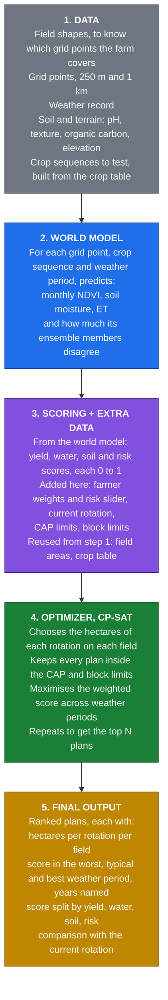
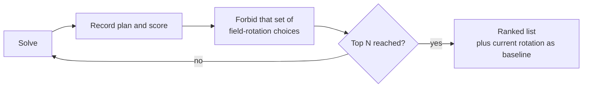

# Rotation optimizer: architecture and visual walkthrough

The optimizer turns the world model's predictions into a ranked list of crop-rotation plans for a farm.
It decides how many hectares of each field go to each rotation, under EU farm rules and the farmer's priorities.
Solver: Google OR-Tools CP-SAT.

Status: being implemented on branch `bogdan/optimizer` as `POST /v1/farm/plan` (code in `services/api/src/api/planner/`, contracts `FarmPlanRequest` / `FarmPlanResponse` / `RotationOutcome` in `services/api/src/api/contracts.py`), fed by a declared mock world model. Scores in the implementation are 0–100, higher is better, as in the team contracts; the 0-to-1 scale below is superseded. Values marked *placeholder* are for the team to set.

## 1. Architecture

Five steps, top to bottom. Nothing flows back up.

**Confirmed:** the world model takes the crop as an input. Its action is the main crop of the crop year plus the
previous one or two crops (team variables table). The planner sits on top and asks the model one question per
candidate rotation.



**What the final output looks like** (plan taken from the toy run, whose scores are random):

| Rank | Field | Hectares | Rotation |
|---|---|---|---|
| 1 | A (37.2 ha) | 7.0 | barley > maize > pea |
| 1 | A | 17.8 | pea > barley > sunflower |
| 1 | A | 12.4 | maize > pea > sunflower |
| 1 | B (8.0 ha) | 8.0 | maize > wheat > maize |

Each rank also carries:

| Field | Meaning |
|---|---|
| Worst case | Farm score in the worst weather period, with its years |
| Typical | Median farm score across weather periods |
| Best case | Farm score in the best weather period, with its years |
| Breakdown | Share of the score from yield, water, soil and risk |
| Versus current | Difference from the farmer's current rotation |

**Optional sixth step, replay:** the farmer picks a past period (say 1987–1990) and the top plans are run through
steps 2 and 3 again on that weather. The result is shown on screen only; it does not change the ranking.

### What the optimizer takes from the world model, and what is extra

**From the world model [WM]**

| Item | Content | Used for |
|---|---|---|
| State | Monthly NDVI, root-zone soil moisture and ET, for each grid point, candidate rotation and weather scenario | Everything about how the land responds: yield, water, soil cover |
| Ensemble spread | Disagreement between the model's ensemble members | The risk indicator and the confidence shown |
| Grid point ID | The model's identifier for each prediction point | Joining predictions to pieces |

**Calculated from the world model output [FROM WM]**

| Item | How |
|---|---|
| Yield indicator | Peak-season NDVI through the yield readout |
| Water indicator | ET against soil moisture |
| Soil indicator | Winter NDVI cover |
| Risk indicator | Spread across scenarios and ensemble members |

**Added beyond the world model [EXTRA]**

| Item | Why the world model cannot supply it |
|---|---|
| Piece areas (field polygons cut by the grid) | The model predicts per point; it does not know field shapes or hectares |
| Crop table: genus, legume flag, summer cover flag | Needed for the CAP rules, which are legal categories, not predictions |
| Return interval per crop | Agronomic rule used to build the candidate list |
| Farmer weights and risk slider | The farmer's preferences |
| Farmer's current rotation | The baseline to compare against |
| CAP limits: 75%, 95%, 80%, 2% | Regulation |
| Block limits: minimum block, rotations per field, whole-field threshold | Practical farming limits |
| Scenario labels: start and end year | So the screen can name the best and worst years |
| Legume years in the soil indicator | Counted from the rotation itself |
| Slope per piece (optional) | Only for the erosion index; soil loss is not part of the state |

**Not passed to the optimizer:** pH, texture, organic carbon, elevation and the weather values. They enter the world
model and reach the optimizer only through the state.

**Three stages, three owners of the logic:**

| Stage | What it does | Runs when |
|---|---|---|
| World model | Predicts the state for every grid point, candidate rotation and weather scenario | A field is added or changed |
| Scoring step | Turns the monthly state into four indicators per piece, rotation and scenario | After each world model run |
| Optimizer | Picks hectares per rotation, applies the rules, ranks plans | Every time the farmer moves a slider |

The optimizer never reads rasters or weather. Its land input is the state. pH, texture and organic carbon are
inputs to the world model only; counting them again here would double count.

## 2. Visual walkthrough

The numbers below are from the toy run. Its scores are random, so the plan itself means nothing; the shapes are what matter.

### Step 1: cut the field by the prediction grid

Field A is 37.2 ha and spans six 250 m cells. Each cell's part of the field is a **piece** with its own predictions.
Field B is 8 ha and sits in one cell.

```
Field A, 37.2 ha                      Field B, 8 ha
+---------+---------+---------+       +---------+
|   A0    |   A1    |   A2    |       |   B0    |
| 6.2 ha  | 6.2 ha  | 6.2 ha  |       | 8.0 ha  |
+---------+---------+---------+       +---------+
|   A3    |   A4    |   A5    |
| 6.2 ha  | 6.2 ha  | 6.2 ha  |
+---------+---------+---------+
```

On the 1 km grid a cell is 100 ha, so most fields fall in one cell and every piece in it gets the same predictions.
A split there comes from the diversification rules and from hedging against bad years, not from differences in the land.

### Step 2: the solver assigns hectares to rotations

```
Field A   |███████ 7.0 ha|▓▓▓▓▓▓▓▓▓▓▓▓▓▓▓▓▓▓ 17.8 ha|░░░░░░░░░░░░ 12.4 ha|
           barley > maize   pea > barley               maize > pea
           > pea            > sunflower                > sunflower

Field B   |████████ 8.0 ha|      one rotation only, the field is below the whole-field threshold
           maize > wheat > maize
```

The solver gives hectares per rotation, not the line where one block ends and the next begins.
The farmer draws the blocks.

### Step 3: the plan is checked against the farm rules every year

| Year | Crop areas (ha) | Largest crop (limit 75%) | Two largest (limit 95%) | Crops (need 3) |
|---|---|---|---|---|
| 1 | maize 20.4, pea 17.8, barley 7.0 | 45% | 85% | 3 |
| 2 | barley 17.8, pea 12.4, wheat 8.0, maize 7.0 | 39% | 67% | 4 |
| 3 | sunflower 30.2, maize 8.0, pea 7.0 | 67% | 85% | 3 |

### Step 4: each plan is scored across weather scenarios

Every scenario is one window of past weather. Each plan gets a farm total per scenario, which gives a range, not one number.

```
                 worst window        typical         best window
                 [years named]                       [years named]
Plan 1           |-----------------====#====-----------------|
Plan 2        |--------------------====#====------------|
Current     |----------------======#======--------|
            low score                                high score
```

The screen names the years behind the best and worst window, so the farmer can compare with years they remember.

### Step 5: ranking



## 3. Optimizer inputs

| Table | Origin | Columns | Source |
|---|---|---|---|
| `scores` | **[FROM WM]** | `piece_id, rotation_id, scenario_id, yield, water, soil, risk` | Scoring step on the world model state |
| `pieces` | **[EXTRA]**, except `grid_point_id` **[WM]** | `piece_id, field_id, farm_id, grid_point_id, area_ha` | Field polygons cut by the prediction grid |
| `candidates` | **[EXTRA]** | `rotation_id, crop_y1..yN` | Enumerated from the crop table |
| `scenarios` | **[EXTRA]** | `scenario_id, start_year, end_year` | Sliding windows over the weather record |
| `crops` | **[EXTRA]** | `crop, genus, is_legume, covers_summer, min_return_years` | Agronomic table, set and cited by the team |
| `params` | **[EXTRA]** | weights, risk slider, rule limits, block limits, current rotation | Farmer and team |

`scores` is the only table that carries world model output. Two parts of it are not pure model output: the legume
years in `soil`, and the optional erosion index.

`grid_point_id` must match the world model's point IDs exactly; it is the join between a piece and its predictions.

**Crops in scope:** maize, wheat, barley, sunflower, pea. Soy is out of scope (team decision, 14 Nov 2026), so pea
is the only legume: the legume share rule and any nitrogen benefit depend on it alone.

## 4. The model

**Decision variable**

- `ha[piece, rotation]`: area of the piece given to the rotation. Integer, in 0.1 ha units.
- `use[field, rotation]`: yes or no, whether the field carries the rotation at all.

**Constraints**

All constraints are **[EXTRA]**: none of them uses world model output.

| Rule | Form |
|---|---|
| Every hectare is planned | Sum of `ha[piece, ·]` equals the piece's area |
| Minimum block | A rotation on a field gets 0 or at least the minimum block (*placeholder* 5 ha) |
| Few rotations per field | At most K rotations per field (*placeholder* 3) |
| Small fields stay whole | Below the threshold (*placeholder* 10 ha), exactly one rotation |
| Rotation (GAEC 7) | No crop two years running; built into the candidate list |
| Return intervals | Per-crop waiting years; built into the candidate list |
| Diversification (GAEC 7) | Per year: largest crop ≤ 75% above 10 ha; two largest ≤ 95% above 30 ha |
| Summer soil cover (GAEC 6) | Per year: covered area ≥ 80% |
| Legume share (eco-scheme, optional) | Per year: legumes ≥ 2% |

**Objective**

The objective is where the world model enters. The four indicators are **[FROM WM]**; the weights, the areas and
`λ` are **[EXTRA]**.

1. Score per unit area: `score = w_yield·yield + w_water·water + w_soil·soil + w_risk·risk`, weights summing to 1.
2. Farm total per scenario: sum of `score × ha` over all pieces and rotations.
3. Maximise `(1 − λ) × average of the scenario totals + λ × worst scenario total`.

`λ` is the risk slider: 0 chases the average year, 1 protects the worst year on record.

In short: the world model decides how good each rotation is on each piece of land; everything extra decides which
combinations are allowed and what the farmer cares about.

**Outputs per ranked plan**

- Hectares per rotation per field.
- Farm total per scenario, giving the worst, typical and best case with years named.
- The four weighted indicator terms, which are the explanation of the score.
- The same figures for the farmer's current rotation, as the baseline.

## 5. What reruns when

| Farmer action | World model | Scoring | Optimizer |
|---|---|---|---|
| Moves a priority weight or the risk slider | no | no | yes, seconds |
| Asks for a custom period (e.g. 1987–1990) | yes, top plans and baseline only | yes | no |
| Changes the plan length or the crop list | yes | yes | yes |
| Adds or edits a field | yes | yes | yes |

## 6. Limits to show on screen

- **Coarse grid:** on 1 km points the tool cannot tell parts of a field apart.
- **Replay is not history:** it shows how today's field would respond to that period's weather, not what happened then.
- **Extrapolation:** the world model is trained on a few recent weather years; older or unusual periods are less certain, and the ensemble spread should show it.
- **Worst case:** the worst window in the record, not a guaranteed floor.
- **Shared weather:** weather cells are tens of kilometres wide, so the whole farm gets the same weather.
- **Rules are payment conditions:** the CAP limits decide subsidy eligibility; they are not legal bans on a rotation.
- **Erosion:** only a relative index if the slope input is used; otherwise not assessed.

## 7. Open choices for the team

- Minimum block size, maximum rotations per field, whole-field threshold.
- Return interval per crop, with a source.
- Whether to include the erosion index, which needs slope per piece.
- How different two ranked plans must be; with the minimum setting, neighbouring ranks can differ on one field only.
- Candidate pruning if 320 rotations per piece (five crops, four years) solves too slowly; tested so far at 72.
- The 2026 text of GAEC 7 and the GAEC 5 slope rule are not yet verified against the APIA 2026 guide.
